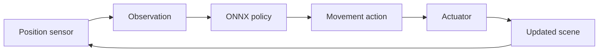

Game engines provide rich environments for reinforcement learning, but connecting a scene to a learning framework requires more than attaching a model to a character. Developers need consistent ways to describe observations, apply actions, manage episodes, and run trained policies.

As part of an **AMD–University of Toronto experiential industry project**, our team is extending [AMD's original Schola toolkit](https://github.com/GPUOpen-LibrariesAndSDKs/Schola) from its Unreal Engine foundation to Unity. The aim is to make Unity environments usable with Schola's Python training ecosystem and bring exported policies back into the engine for local inference.

**My role:** Unity integration lead and AMD partner liaison 
**Timeline:** September 2026–present · Progress documented through October 2026 
**Technologies:** C#, Unity 6.3, Python, ONNX, Protobuf, GitHub Actions

**Current outcome:** Working Unity agents, local episode control, and ONNX inference. End-to-end Unity–Python training integration remains unfinished.

## My role and contributions

My work connects interface design, integration, developer tooling, and communication with AMD. The underlying runtime is a team effort: teammates implemented the sensor and actuator paths, environment lifecycle, ONNX policy, and inference stepper.

- **Unity interface design.** I led the early design of environment, agent, sensor, actuator, and policy abstractions, and built an editor workflow prototype to support technical discussions with AMD.
- **Protocol-generation checks.** I wrote the Protobuf-to-C# generation script and its CI workflow. Nine regression tests cover tool integrity, missing or changed generated files, failed generation, baseline deletion, and preservation of Unity metadata.
- **Architecture and documentation.** I created architecture/UML diagrams, documented the demo's setup and failure cases, captured screenshots, and recorded the walkthrough. These artifacts explain how individual components become a usable workflow.
- **Partner coordination.** As AMD liaison, I coordinated communication, scheduled discussions, and brought questions about interfaces, integration, and scope to the partner team. I also assembled the Return to Base display demo and recorded its walkthrough to show AMD the team's progress.

My contribution to CI is specifically the code-generation tooling and checks, alongside review and merge support. The broader pipeline was built and integrated collaboratively.

## How the system works

The implemented local inference path follows an **observe → think → act** cycle:

`PositionSensor` reads world position into a keyed observation. `SentisPolicy` evaluates the model through Unity Inference Engine, and `TranslateActuator` applies the resulting movement. `SimpleStepper` coordinates the cycle: all agents observe before any acts, and policy decisions are collected before actions are applied.

The shared `Space` and `Point` types describe what observations and actions contain. Matching keys, dimensions, and value counts is essential: a model can load successfully yet still be incompatible with an agent's input or output contract. Keeping these definitions explicit helps detect mismatches at the component boundary.

Separately, `ScholaEnvironment` provides local initialization, stepping, and reset behavior. A step applies actions, calculates reward and episode status, then collects observations. Reset restores the initial pose snapshot and notifies episode hooks. Those APIs establish the Unity side of episode management; they do not, by themselves, connect it to a Python trainer.



My generation tooling addresses another integration risk: protocol definitions and generated C# can drift apart. It uses checksum-verified generation tools and compares output without overwriting the committed baseline during checks. CI validates generation now; comparison against committed sources activates once the first generated C# baseline exists.

## From design to implementation

Before the runtime pieces came together, I created an **editor-only UI mockup** covering training, environments, agents, sensors, actuators, spaces, and inference. It gave us concrete screens to discuss how a Unity developer might configure Schola.

  

    
  

  

    
  

These images document the design process. Their configuration fields are read-only, and they do not train agents, execute policies, or save settings. The partner demonstration below uses the actual runtime components rather than this proposed interface.

The team has also added EditMode tests for observations, action validation, episode lifecycle, model compatibility, and stepping. CI includes formatting and metadata checks, Unity test automation, Python regression checks, protocol generation, and release tooling. The headless Unity smoke-test path still depends on a dedicated player project; existing mock-protocol checks are not evidence of completed Unity–Python integration.

## Partner progress demo: Return to Base

We created **Return to Base** as a display environment to show our AMD partner the progress we had made on the Unity toolkit. It is a presentation demo, not a required component or deliverable of the toolkit; Schola's functionality does not depend on this scene.

I assembled the scene using the team's runtime components. Six cube-shaped drones share a trained ONNX model and move toward a blue base, each using its own position observation and movement action. This gives us a simple, visible way to demonstrate the inference loop during a partner review.

Clicking a drone moves it away from the base. Dragging lets you place it elsewhere, and pressing Space scatters all six. Once released, the policy guides each drone home again. Orange drones turn green within the home threshold, while a counter makes the result easy to follow.

  <iframe
    src="https://www.youtube-nocookie.com/embed/utxF_vXdSw8"
    title="AMD Schola for Unity: partner progress demonstration — Return to Base"
    loading="lazy"
    allow="encrypted-media; picture-in-picture; fullscreen"
    allowfullscreen
  ></iframe>

[Watch the partner progress demo walkthrough on YouTube](https://youtu.be/utxF_vXdSw8).



  

    
  

  

    
  

This demonstrates **inference with an already-trained model**, not training during Play Mode. No Python process is needed to run it. The screenshots explicitly show the trained ONNX policy in the overlay; the demo also has a fallback controller, so movement alone would not establish that model inference was running.

## Current status and next steps

The following reflects the inspected October 2026 implementation and demo artifacts, rather than a claim of production readiness.

| Area                           | Current state                                                               |
| ------------------------------ | --------------------------------------------------------------------------- |
| Agents, sensors, and actuators | Implemented, with keyed observation/action contracts and validation.        |
| Local episode control          | Initialization, step, reset, reward, and termination hooks implemented.     |
| ONNX inference                 | Policy execution and the observe–think–act stepper implemented.             |
| Editor interface               | Exploratory mockup; no connected backend.                                   |
| Unity–Python training          | Unfinished integration work; not part of the current demonstrated workflow. |
| Packaged setup sample          | In progress; intended to help developers set up and use the toolkit.        |
| Headless Unity smoke testing   | Workflow prepared; player project and integration prerequisites remain.     |

The next milestone is a reliable training connection that preserves the same observation/action contracts and episode semantics used locally. That needs to be followed by an importable setup sample and a headless Unity test that exercises the real connection.

[Watch the partner demo](https://youtu.be/utxF_vXdSw8) · [Explore upstream AMD Schola](https://github.com/GPUOpen-LibrariesAndSDKs/Schola) · [Contact me](mailto:mahi.mukati@mail.utoronto.ca)

<small>Demo captures, editor mockups, and architecture diagram by Mohammad Mahi Ali Mukati for the team project. AMD Schola is an AMD project. <a href="{{ '/assets/img/amd-schola/NOTICE.txt' | relative_url }}">Media attribution and license</a>.</small>
